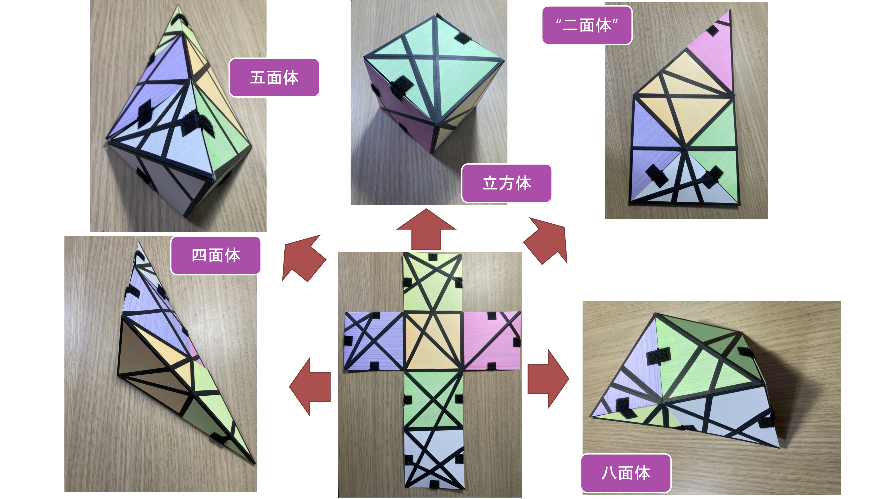
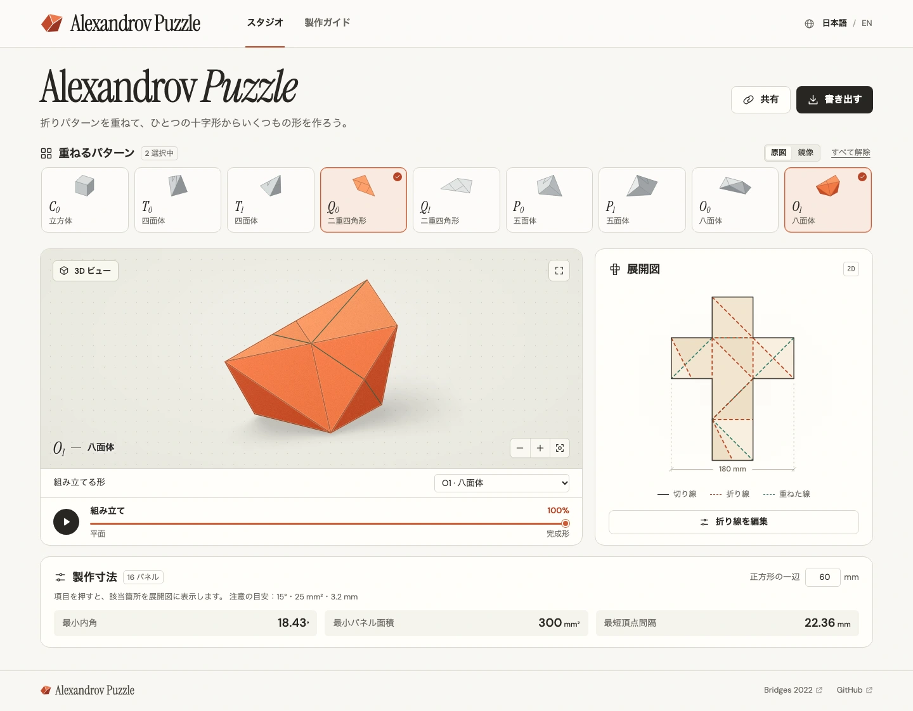
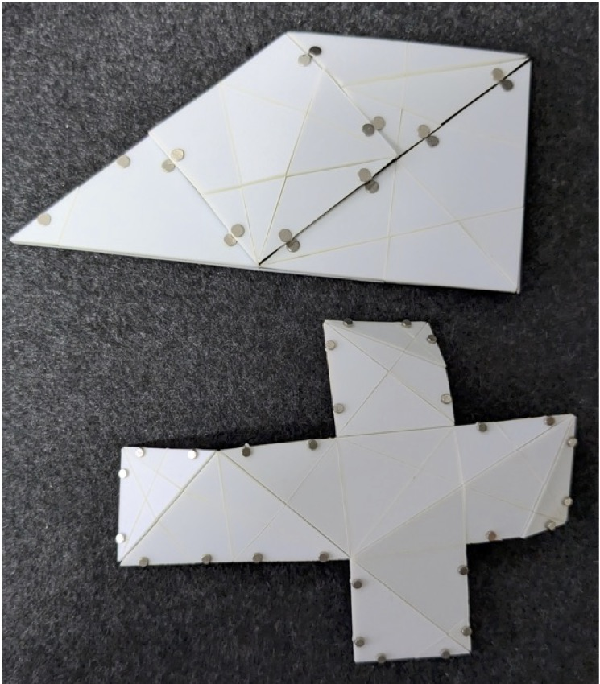
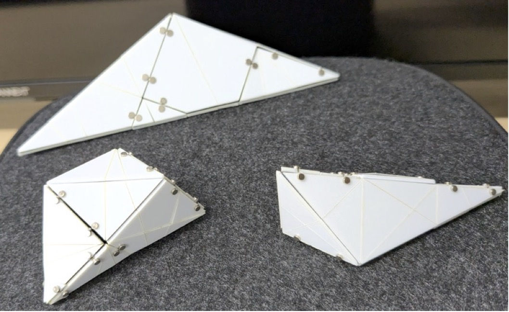

# Alexandrov Puzzle

**[GitHub Pages でパズルを開く](https://shizuo-kaji.github.io/AlexandrovPuzzle/?lang=ja)**

[English](README.md) · **日本語**

6個の正方形でできた十字形から、いくつの形を作れるでしょうか。「アレクサンドロフパズル」では、ヒンジでつながった同じ1枚のシートを5種類の形に折り替えられます。このアプリでは、ブラウザ上で折り線を組み合わせてシートを設計し、折り方を確かめ、紙や3Dプリンタで実物を作れます。[原論文（Bridges 2022）](https://archive.bridgesmathart.org/2022/bridges2022-371.html)



## パズルのしくみ

十字形の外周には、正方形の一辺と同じ長さの辺が14本あります。パズルの課題は、どの辺を対にして貼り合わせ、どこを折れば目的の形になるかを見つけることです。アレクサンドロフの貼り合わせ定理によれば、貼り合わせた面が球面と同相で、各点に集まる角の和が360°以下なら、その面の内在的な距離から凸多面体が合同を除いて一意に定まります。平面の多角形を表裏から二重に覆う場合も含みます。また、貼り合わせた辺が完成形の面の途中を通ることもあります。

原論文では、境界上の1頂点を選び、そこで出会う2本の辺を端から合わせる操作（*zipping*）を繰り返して、辺と辺の貼り合わせ方を列挙しています。辺を1本ずつ対にして閉じると、できる形は次の5種類です。左右反転を同一視すると折り線のパターンは9種です。立方体以外の8パターンには異なる鏡像があり、アプリでは右肩の *m* で表します。

| 完成形 | 原図のパターン |
| --- | --- |
| 立方体 | C0 |
| 二重に覆われた四角形 | Q0、Q1 |
| 四面体 | T0、T1 |
| 五面体 | P0、P1 |
| 八面体 | O0、O1 |

<details>
<summary>外周の14頂点の番号</summary>

```text
      14───1
       │   │
  12──13   2───3
   │           │
  11──10   5───4
       │   │
       9   6
       │   │
       8───7
```

折り線の定義では、十字形の上端の右角を1とし、外周の頂点に時計回りに番号を付けています。型紙の A–G は、そのパターンで貼り合わせる7組の辺を表します。[折り線の定義](web/geometry/patterns.js)

</details>

## 展開図を設計する

1. **重ねるパターン** で作りたい形のカードを選ぶと、それぞれの折り線が同じ十字形に重なります。例えば O1 と Q0 を選ぶと、八面体にも平らな四角形にも折れるシートを設計できます。
2. **組み立てる形** を切り替え、**組み立て** スライダーを動かして、それぞれの折り方を見比べます。**折り線を編集** では個々の線を有効・無効にしたり、外周で対になる7組の辺の記号 A–G を表示したりできます。
3. **製作寸法** で正方形の一辺を20〜60 mmに設定します。折り線の交点で区切られた各領域が1枚のパネルです。**最小内角**・**最小パネル面積**・**最短頂点間隔** の値を押すと、その箇所を展開図で確認できます。工作上の目安として、それぞれ15°・25 mm²・3.2 mmを下回ると注意が表示されます。
4. **共有** で、選んだ折り線・組み立てる形・寸法を含むリンクをコピーできます。**書き出す** を押すと、ブラウザ内で製作用ファイルを生成します。



## 実物を作る

| 出力 | 作り方 |
| --- | --- |
| 紙の展開図（PDF） | A4またはLetterに原寸（100%）で印刷します。基準尺を測り、外周を切って破線で折ります。複数のパターンを重ねた場合は、共通の型紙に続いて、完成形ごとの折り線と貼り合わせる辺を示すページが付きます。 |
| 完成模型（STL） | 折り線と貼り合わせた辺に浅い溝が入った状態で、組み立てた形を印刷できます。平面に重なるQ系は表裏の模様が見える厚さ2.4 mmの模型になります。 |
| テープヒンジ式キット | 厚さ1.2 mmのパネルを平らに印刷し、型紙の上に並べます。ヒンジになるすき間を薄いテープでつなぎます。 |
| 磁石ブリッジ式キット | 印刷したパネルのくぼみに円板磁石を入れ、布に磁石を縫い込んだブリッジでつなぎます。ブリッジを取り外して外周を開くと折り替えられます。 |
| スナップリンク式キット | ボタン付きのパネルを硬質フィラメントで、リンクを柔らかいTPUで印刷します。配置図の指示に従ってリンクをボタンにはめます。 |

各キットのZIPにはパネルのデータ、原寸型紙、日英の製作手順が入ります。磁石式・スナップ式には試験片と配置図が付き、手順書には必要な部品数が記載されます。全体を印刷する前に、使うプリンタと材料で試験片の着脱を確認できます。組み立てる順序はアプリの **製作ガイド** にも掲載しています。

 

## ローカルで起動する

Node.js 22以降を用意し、リポジトリのルートで開発サーバーを起動します。

```sh
npm run dev
```

ブラウザでスタジオを開き、画面上部の **日本語** または **EN** で表示言語を選びます。[ローカルのスタジオ](http://127.0.0.1:4173/)

`npm test` で折り方の幾何、印刷用メッシュ、書き出しを検証できます。`npm run build` を実行すると、公開用の静的ファイルが `dist/` に生成されます。


## 参考文献

- 竹永耕大・梶静雄「Alexandrov Puzzle」*Proceedings of Bridges 2022*, pp. 371–374. [論文・補足資料](https://archive.bridgesmathart.org/2022/bridges2022-371.html)
- A. D. Alexandrov. *Convex Polyhedra*. Springer Monographs in Mathematics, 2005. [書籍](https://doi.org/10.1007/b137434)
- Anna Lubiw、Joseph O’Rourke. “When Can a Polygon Fold to a Polytope?” Smith College Technical Report 048, 1996. 同年、米国ニュージャージー州ローレンスビルのAMS会議で発表。[著者による文献一覧](https://www.science.smith.edu/~jorourke/papers.php)
- Erik Demaine、Martin Demaine、Anna Lubiw、Joseph O’Rourke、Irena Pashchenko. “Metamorphosis of the Cube.” *SoCG ’99*, pp. 409–410. [論文・動画](https://erikdemaine.org/papers/SoCG99v/)
- Erik D. Demaine、Joseph O’Rourke. *Geometric Folding Algorithms: Linkages, Origami, Polyhedra*. Cambridge University Press, 2007. [書籍・補足資料](https://www.gfalop.org/)
- Daniel Kane、Gregory N. Price、Erik D. Demaine. “A Pseudopolynomial Algorithm for Alexandrov’s Theorem.” *WADS 2009*, Lecture Notes in Computer Science 5664, pp. 435–446. [論文](https://erikdemaine.org/papers/Alexandrov_WADS2009/)
