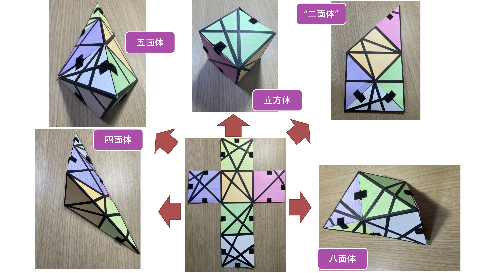
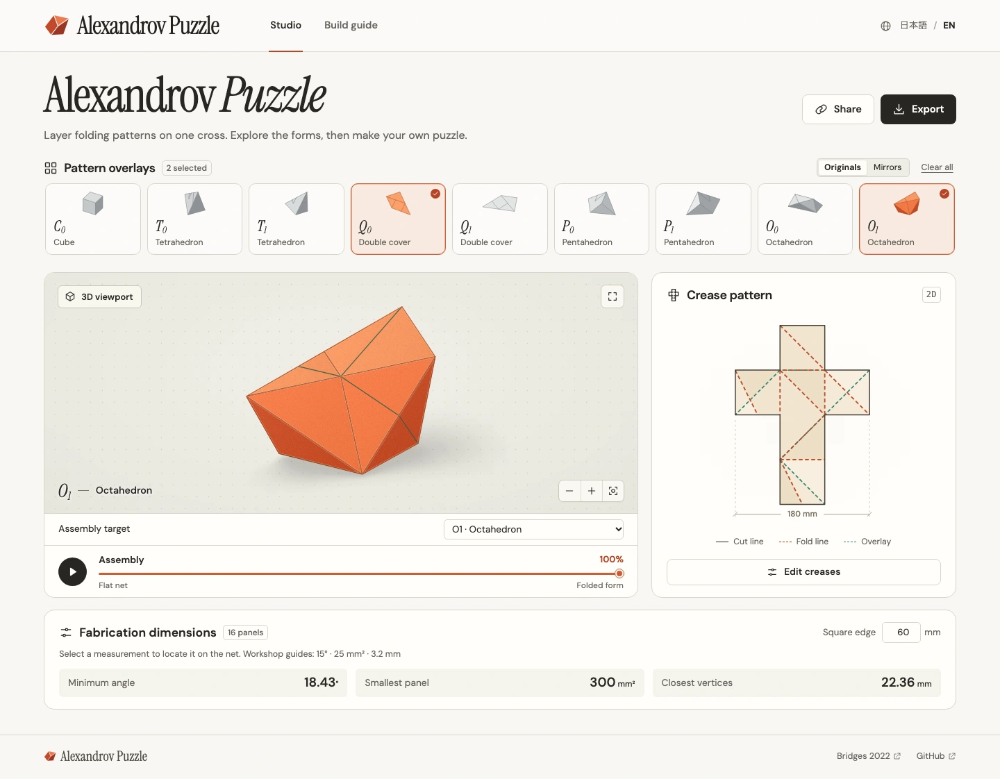
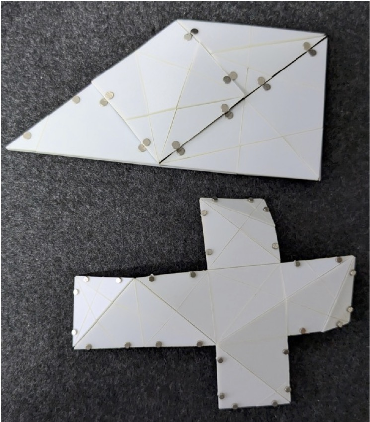
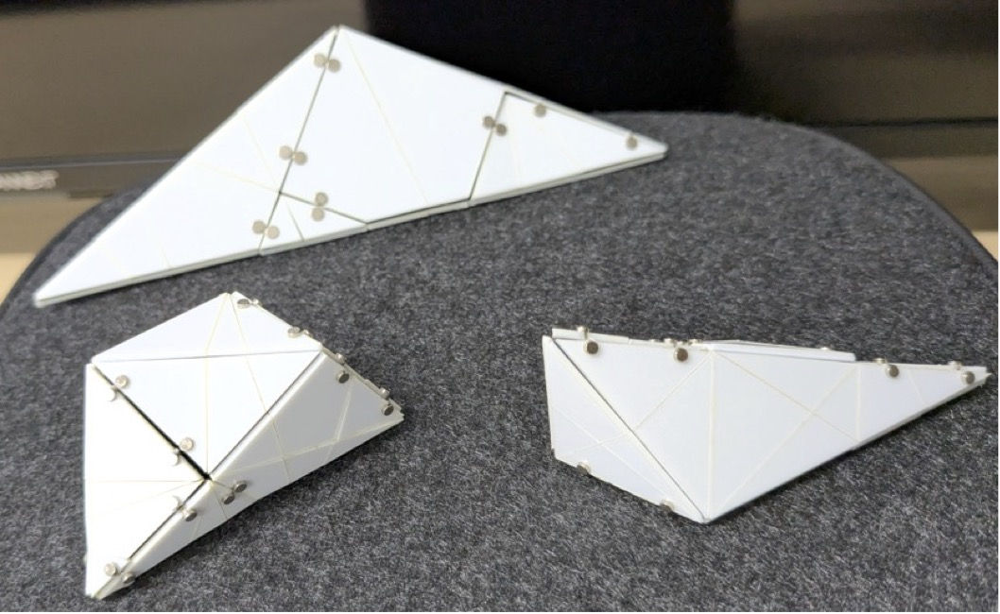

# Alexandrov Puzzle

**[Open the interactive puzzle on GitHub Pages](https://shizuo-kaji.github.io/AlexandrovPuzzle/?lang=en)**

**English** · [日本語](README.ja.md)

How many shapes can you make from a single cross of six squares? In Alexandrov Puzzle, the same sheet can close into five different shapes. This browser app lets you design the sheet, watch it fold and make a copy from paper or 3D-printed panels. [Original paper, Bridges 2022](https://archive.bridgesmathart.org/2022/bridges2022-371.html)



## How the puzzle works

The cross has fourteen unit edges around its boundary. Choose which edges to join in pairs and where to fold the paper. Alexandrov’s gluing theorem says that if the joined surface has the topology of a sphere and the angles meeting at every point sum to at most 360°, its intrinsic geometry determines a unique convex polyhedron up to congruence. This includes the flat case of a polygon covered on both sides. A joined edge can run across the middle of a face.

We enumerate whole-edge pairings by *zipping*. Each step joins the two boundary edges meeting at a chosen vertex. Repeating the operation closes the surface. The nine crease patterns below give the five possible shapes under these edge-to-edge gluings. The eight non-cube patterns each have a distinct mirror image, marked with a superscript *m* in the studio.

| Shape | Original patterns |
| --- | --- |
| Cube | C0 |
| Doubly covered quadrilateral | Q0, Q1 |
| Tetrahedron | T0, T1 |
| Pentahedron | P0, P1 |
| Octahedron | O0, O1 |

<details>
<summary>How the 14 boundary vertices are numbered</summary>

```text
      14───1
       │   │
  12──13   2───3
   │           │
  11──10   5───4
       │   │
       9   6
       │   │
       8───7
```

The crease definitions number the boundary vertices clockwise from the upper right corner. The letters A–G on a printed template identify the seven pairs of edges to join for that particular pattern. [Crease definitions](web/geometry/patterns.js)

</details>

## Design a sheet

1. In **Pattern overlays**, select the patterns you want to build. The net shows their combined creases. For example, choose O1 and Q0 to make one sheet that folds into an octahedron or a flat quadrilateral.
2. Switch **Assembly target** between the selected patterns and move the **Assembly** slider. Use **Edit creases** to try individual folds or display the seven pairs of matching seam letters A–G.
3. In **Fabrication dimensions**, set the square edge to 20–60 mm. Intersections between creases divide the sheet into panels. Select **Minimum angle**, **Smallest panel** or **Closest vertices** to locate the corresponding feature on the net. Workshop warnings appear below 15°, 25 mm² and 3.2 mm, respectively.
4. **Share** copies a link to your design, including the crease selection, target and dimensions. **Export** generates the fabrication files in your browser.



## Make the puzzle

| Export | What to do with it |
| --- | --- |
| Paper net (PDF) | Print on A4 or Letter at 100%. Check the scale bar, cut the outer boundary and fold along the dashed lines. A combined net includes an extra page for each target showing which creases to fold and which edges to join. |
| Folded model (STL) | Print the assembled shape with shallow grooves marking creases and joined edges. The flat Q models are 2.4 mm thick so that the pattern is visible on both sides. |
| Tape hinge kit | Print the 1.2 mm panels flat, arrange them on the template, and bridge the hinge gaps with thin tape. |
| Magnetic bridge kit | Fit disc magnets into the printed panels and sew matching magnets into short fabric bridges. The bridges detach so you can reopen the seams. |
| Snap link kit | Print the studded panels in rigid filament and the links in flexible TPU. Snap the links over the studs indicated on the placement diagram. |

Each kit ZIP contains the panel files, a full-size template and instructions in English and Japanese. Magnetic and snap kits include fit samples, placement diagrams and part counts. Try the sample with your printer and material before printing the full kit. Open **Build guide** for the assembly sequence.

 

## Run locally

With Node.js 22 or later, start the development server from the repository root.

```sh
npm run dev
```

Open the studio and choose **EN** or **日本語** in the header. [Local studio](http://127.0.0.1:4173/)

Run `npm test` to check the geometry, fabrication meshes and exports. Run `npm run build` to generate the static site in `dist/`.

## References

- Kodai Takenaga and Shizuo Kaji. “Alexandrov Puzzle.” *Proceedings of Bridges 2022*, pp. 371–374. [Paper and supplement](https://archive.bridgesmathart.org/2022/bridges2022-371.html)
- A. D. Alexandrov. *Convex Polyhedra*. Springer Monographs in Mathematics, 2005. [Book](https://doi.org/10.1007/b137434)
- Anna Lubiw and Joseph O’Rourke. “When Can a Polygon Fold to a Polytope?” Smith College Technical Report 048, 1996. Presented at the AMS conference in Lawrenceville, New Jersey. [Author’s bibliography](https://www.science.smith.edu/~jorourke/papers.php)
- Erik Demaine, Martin Demaine, Anna Lubiw, Joseph O’Rourke and Irena Pashchenko. “Metamorphosis of the Cube.” *SoCG ’99*, pp. 409–410. [Paper and video](https://erikdemaine.org/papers/SoCG99v/)
- Erik D. Demaine and Joseph O’Rourke. *Geometric Folding Algorithms: Linkages, Origami, Polyhedra*. Cambridge University Press, 2007. [Book and supplementary material](https://www.gfalop.org/)
- Daniel Kane, Gregory N. Price and Erik D. Demaine. “A Pseudopolynomial Algorithm for Alexandrov’s Theorem.” *WADS 2009*, Lecture Notes in Computer Science 5664, pp. 435–446. [Paper](https://erikdemaine.org/papers/Alexandrov_WADS2009/)
